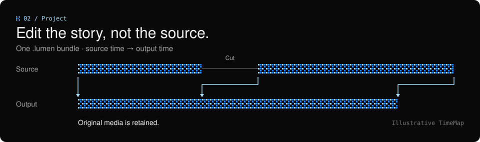
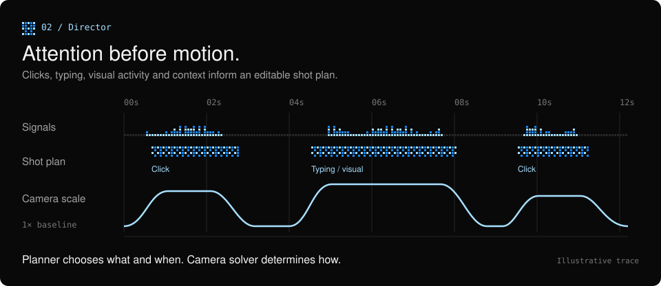
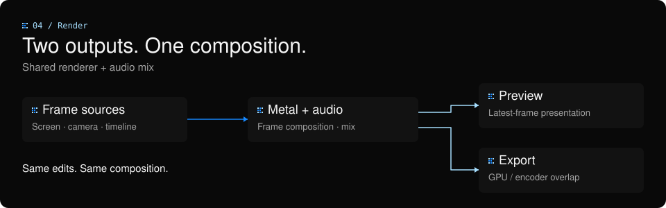
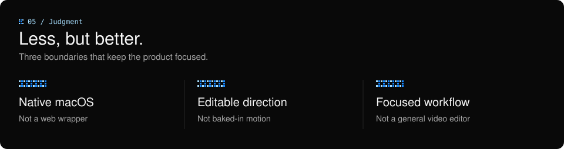
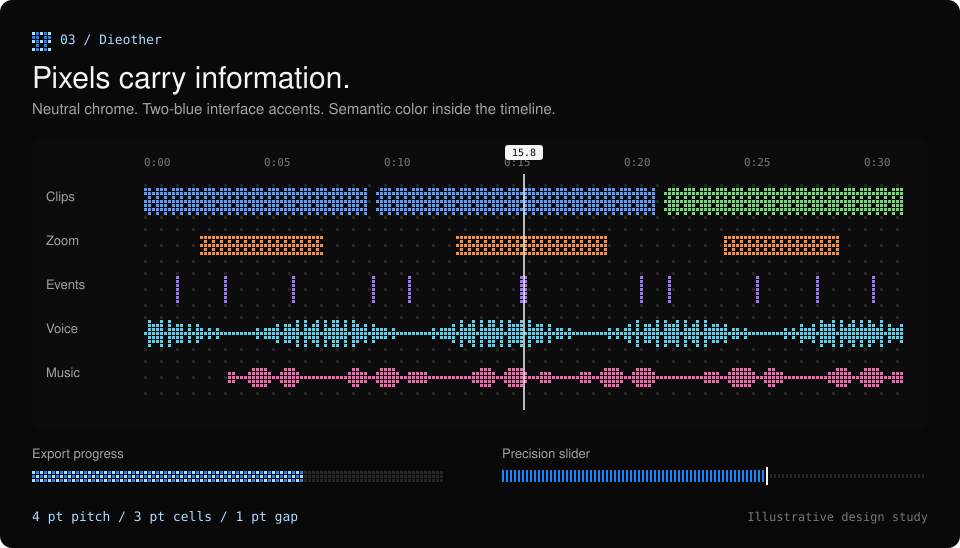

<p align="center">
  
</p>

<p align="center">Native macOS screen recording, intelligent direction and an editable pixel timeline.</p>

## Why I built this

Screen Studio was $29/month when I started. I tried at least ten alternatives, including [Cap](https://cap.so/). None gave me the output quality, intelligent intent tracking or editing experience I wanted. Some had deeper capture and post-processing problems; poor UI was the cherry on top.

I built the first prototype on November 4, 2026. A basic recorder worked the next day.

## Architecture




Original media and events stay in a `.lumen` bundle; edits live on the timeline. `ProjectSession` coordinates readers, analysis and audio; `TimeMap` resolves source and output time.

## The Director



The Planner groups clicks, typing, visual activity and context into shots. A critically damped camera solver produces continuous motion. Automatic direction stays editable.



## Product judgment



Strong defaults over feature sprawl. Manual control where automation gets it wrong.

## Design language



Neutral black, bright blue and light blue. A 4-point lattice with deterministic Bayer cells; real audio peaks in the editor and no continuous idle raster loop.

## The first failure

Recording worked in a day. Reliable post-processing was harder: attention, timing, camera motion and audio had to agree on the final frame.

**Under construction, not release-ready.** The pipeline has been substantially revised; real-device and end-to-end verification remain. Diagrams are illustrative, not benchmarks.

## Build from source

Apple Silicon · macOS 15+ · Xcode + Metal toolchain.

```sh
make build
make test
make app
make verify
open .build/Lumen.app
make probe
```

If needed: `xcodebuild -downloadComponent MetalToolchain`. Local signing is ad hoc unless `CODE_SIGN_IDENTITY` is set; the bundle is not notarized. Clean-machine permissions and physical-device acceptance are not certified by `make verify`.

[Core features](CORE-FEATURES.MD) · [Design contract](DESIGN.md) · [MCP and agent permissions](Docs/agent-platform.md) · [Verification](Docs/Verification/)

<details>
<summary>Implementation notes</summary>

- DeepFilterNet3 failures pass through original microphone audio; CLI sync reports offsets, not render-level validation.
- Music uses loop/trim crossfades rather than beat detection; mesh backgrounds are static.
- Unsplash backgrounds need an access key; email opens a draft, not SMTP.
- The in-app MCP server is opt-in, localhost-only and token-protected. The daemon uses a private socket and explicit capability approvals.
- Regenerate diagrams: `python3 scripts/generate_readme_svgs.py`.

</details>
