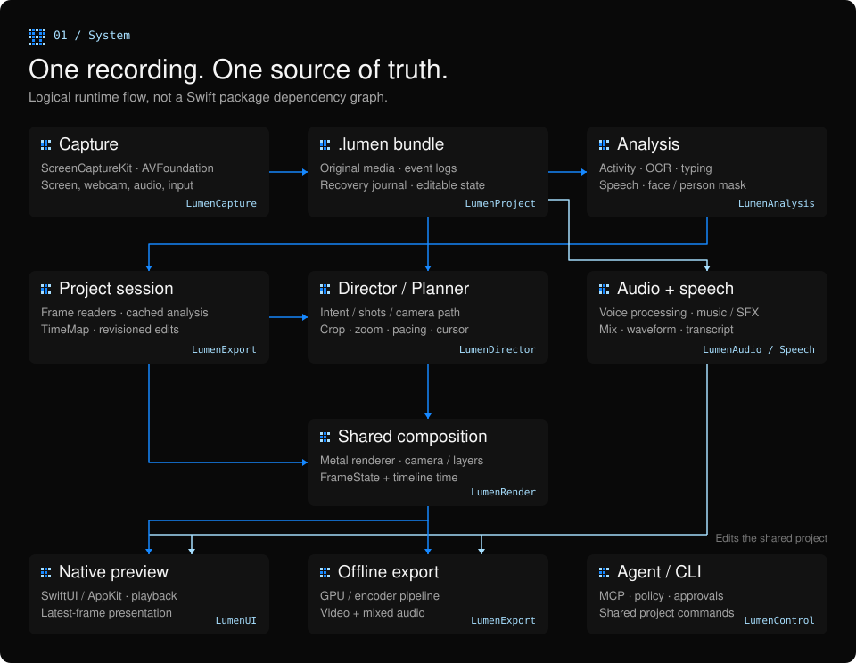

<p align="center">
  
</p>

<h1 align="center">Lumen Studio</h1>
<p align="center">A native macOS screen recorder with an intelligent Director and an editable, pixel-native timeline.</p>

## Why I built this

Screen Studio was charging $29 a month when I started looking for alternatives. I tried at least ten recorders, including [Cap](https://cap.so/) and other open-source tools. None gave me the combination I wanted: sharp output, intelligent direction and a genuinely good editing experience.

Some felt bloated. Others had capture, motion or post-processing problems that no amount of interface polish could hide. The poor UI was just the most visible symptom.

I built the first prototype on November 4, 2026. By November 5, a basic recorder was working. It proved the idea, not the quality of the implementation. Lumen grew out of that gap.

## Architecture



Every recording lives in a `.lumen` project bundle. Original media, input events and recovery data are kept separate from the editable timeline. Camera decisions, cuts and creative choices can change without rewriting the source recording.

The application is built with Swift, SwiftUI, AppKit, ScreenCaptureKit, AVFoundation and Metal. `ProjectSession` coordinates frame sources, analysis and audio preparation; `TimeMap` resolves source time against edited output time. Preview and export share the renderer and audio-mixing logic, rather than maintaining independent composition systems.

## The Director


The Planner converts clicks, typing traces, accessibility context, activity and explicit markers into candidate shots. It chooses focus, framing, scale and duration. The camera solver turns those decisions into a continuous path, using critically damped motion and a high-resolution internal camera track.

A cursor passing through a control is not necessarily a reason to zoom. A sustained typing interaction or meaningful visual change can be. The design goal is to show what matters, hold long enough to understand it and return to context when the action is over. Automatic decisions remain editable.

## Product judgment

I chose a native macOS application over an Electron wrapper or a cross-platform abstraction. I chose editable direction over destructive, baked-in effects. I chose a focused recording workflow over trying to recreate a general-purpose video editor.

The goal is not to expose every possible setting. It is to make a recording look considered before the user touches a single control, while keeping manual control where the automation gets it wrong.

## Design language


The Dieother theme uses neutral-black surfaces, bright blue (`#1688FF`) and light blue (`#A7DFFF`) as interface signals. The timeline retains distinct media colors because they convey meaning.

The same pixel vocabulary appears in the timeline, progress indicators, sliders and SF Symbol-derived glyphs. A 4-point lattice, 3-point cells and deterministic Bayer dithering create the visual rhythm. Voice and music waveforms are derived from audio peaks; the idle timeline does not need a continuous raster loop.

## The first failure, and where it stands

The first prototype worked in a day. Making the result reliable was a different problem. The hard part turned out to be post-processing: the relationship between attention, timing, camera motion, audio and the final rendered frame.

Lumen is still under construction. It is **not a stable release**. The architecture is connected and substantial work has gone into correcting the original pipeline, but post-processing quality, real-device behavior and end-to-end reliability still need release-level verification. No performance claims are implied by the diagrams.

## Build from source

Apple Silicon, macOS 15+, Xcode and the Metal toolchain are required. If needed, install Metal with `xcodebuild -downloadComponent MetalToolchain`.

```sh
make build       # Debug app and CLI
make test        # Integration and algorithm checks
make app         # Release bundle at .build/Lumen.app
make verify      # Tests, packaging, signing and launch checks
open .build/Lumen.app
make probe       # Encoder capabilities on this Mac
```

Local builds use ad hoc signing by default; set `CODE_SIGN_IDENTITY` for a persistent signing identity. The packaged build is not notarized. The app icon is generated from `App/public/assets/brand/logo/lumen-icon.png`.

Agent control is available through the CLI's MCP transport and a headless daemon with explicit capability approvals. See [agent platform](Docs/agent-platform.md), [design contract](DESIGN.md) and [core features](CORE-FEATURES.MD). The in-app MCP server is opt-in, localhost-only and token-protected.

The repository includes Metal performance, golden-image, synchronization and long-capture test harnesses. `make verify` is not a substitute for clean-machine permissions testing or physical-device acceptance. See the [verification reports](Docs/Verification/) for evidence and remaining limitations. DeepFilterNet3 failures pass the microphone signal through unchanged; the CLI `sync` command reports offsets rather than performing render-level sync validation. Music uses loop/trim crossfades, not beat detection; mesh backgrounds are static. Unsplash photo backgrounds require an access key, and email notifications open a draft rather than sending mail.

Regenerate the README diagrams with `python3 scripts/generate_readme_svgs.py`. The illustrations are deterministic and require no third-party Python packages.
